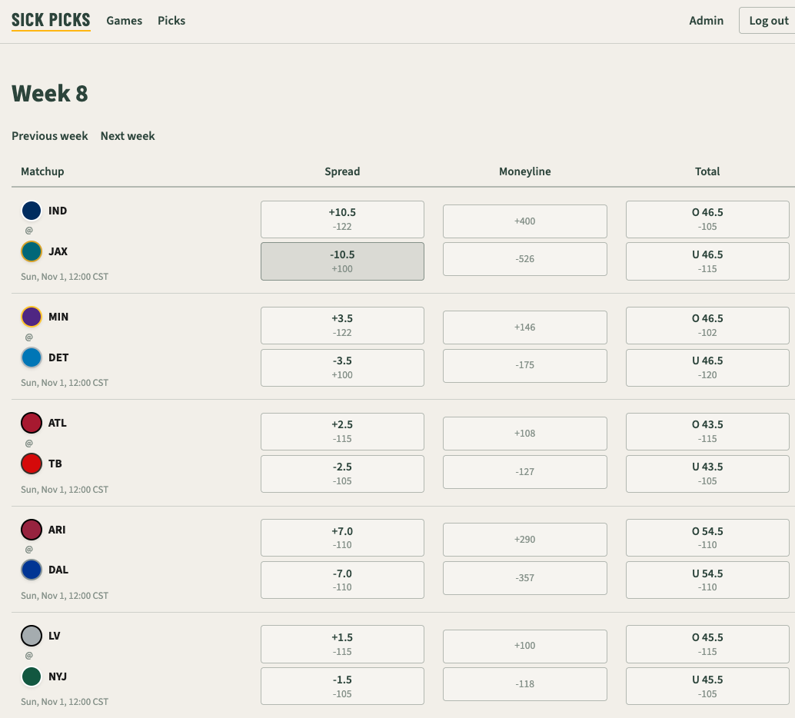

# Sick Picks

Weekly NFL picks before kickoff — spread, moneyline, or total — graded from live odds and scores.

## Demo

**Live app:** [https://sick-picks.onrender.com/](https://sick-picks.onrender.com/)

## Features

- Sign in and open the current week’s slate of games that have not kicked off yet
- Submit one pick per market per game (spread, moneyline, or total) with HTMX row updates
- Lock in the line you saw; stale submissions are rejected when the book moved
- Review pick history by week or season, with results, points, and American odds display
- Sync NFL games, lines, and scores from The Odds API into immutable line snapshots
- Settle final and cancelled games into win, loss, push, or void (CLI or Django admin)
- Show kickoff times in the viewer’s timezone

## Tech stack

| Area | Choices |
| --- | --- |
| App | Python 3.14, Django 5.2, django-htmx, server-rendered templates |
| Data | PostgreSQL 17, dj-database-url, psycopg |
| Tooling | uv, ruff, mypy (django-stubs), pytest-django, Lefthook |
| Ops | Gunicorn, WhiteNoise, GitHub Actions, Render |
| Integrations | The Odds API; production Postgres via `DATABASE_URL` (Neon) |

## Architecture

**Domain.** Three Django apps — `accounts`, `sports`, and `picks`. A `Game` collects immutable `GameLine` snapshots from the provider; a `Pick` ties a user to a game, market, and the line they locked. Sync upserts games and lines; settlement grades picks once a game is final or cancelled. Details live in [docs/DOMAIN.md](docs/DOMAIN.md).

**Infrastructure.** Locally the app runs on the host against Postgres in Docker Compose. Production is a Render web service with Gunicorn and a managed Postgres `DATABASE_URL`. CI runs `make ci` on GitHub Actions. NFL sync and settle are manual today (CLI or admin), not scheduled. See [docs/infrasturcture_architecture_v0.mmd](docs/infrasturcture_architecture_v0.mmd).

## Development

Local setup uses uv, Docker Compose for Postgres, and Lefthook for git hooks. Quality gates are `make check` locally and `make ci` in GitHub Actions.

Full Getting Started, hooks/CI, and NFL seed/sync pointers: **[docs/DEVELOPMENT.md](docs/DEVELOPMENT.md)**.

---

*This website is a personal project and is not affiliated with, endorsed by, or sponsored by the National Football League (NFL) or any of its teams. All team names and betting data are used strictly for informational purposes.*
